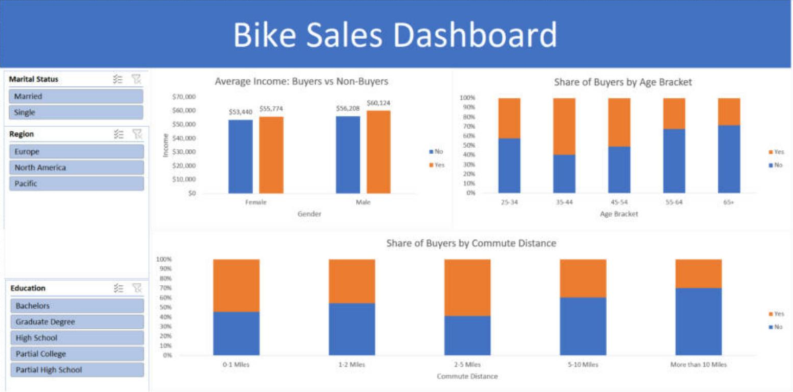

# Bike Sales Dashboard (Excel)

An Excel project that cleans a dataset of 1,000 customers, summarises it with pivot tables and presents an interactive dashboard showing who is most likely to buy a bike.

## Key findings

48% of customers in the dataset bought a bike. The share varies a lot by segment:

| Segment | Highest share of buyers | Lowest share of buyers |
|---|---|---|
| Age | 35-44 (60%) | 65+ (29%) |
| Commute distance | 2-5 miles (59%) and 0-1 miles (55%) | More than 10 miles (30%) |
| Region | Pacific (59%) | North America (43%) |
| Cars owned | 0 cars (61%) | 2 or more cars (about 36-39%) |
| Marital status | Single (54%) | Married (43%) |

- **Age matters most in the middle.** Buying peaks at 35-44 and drops sharply from 55 onwards.
- **Short commutes sell bikes.** Customers who live within 5 miles of work buy far more often than those more than 10 miles away.
- **Income is a weak signal.** Buyers earn about $58,000 on average against about $55,000 for non-buyers.

**Recommendation:** target customers aged 35-54 with a commute under 5 miles and one car or none, starting in the Pacific region.

## What I did

1. **Cleaning** (`Cleaned Data` tab)
   - Removed 26 duplicate rows (1,026 rows down to 1,000 unique customers).
   - Replaced coded values with readable labels (`M`/`S` to Married/Single, `M`/`F` to Male/Female).
   - Standardised number formats for income.
   - Added an `Age Brackets` column with a nested `IF` formula: 25-34, 35-44, 45-54, 55-64, 65+.
2. **Analysis** (`Pivot Tables` tab)
   - Average income by gender and purchase.
   - Purchases by commute distance.
   - Purchases by age bracket.
3. **Dashboard** (`Dashboard` tab)
   - Three pivot charts connected to slicers for marital status, region and education.
   - Age and commute charts are 100% stacked columns, so each bar shows the share of buyers and segments of different sizes can be compared fairly.

## How to use it

1. Download `Bike_Sales_Dashboard.xlsx` and open it in Microsoft Excel (desktop version, 2016 or later).
2. Go to the `Dashboard` tab.
3. Click the slicers on the left to filter all three charts at once.

## Files

| File | Contents |
|---|---|
| `Bike_Sales_Dashboard.xlsx` | Workbook with four tabs: Raw Data, Cleaned Data, Pivot Tables, Dashboard |
| `images/dashboard.png` | Screenshot of the dashboard |

## Tools

Microsoft Excel: Remove Duplicates, nested `IF`, pivot tables, pivot charts, slicers.

## Credits

The dataset and the original walkthrough come from [Alex The Analyst's Excel tutorial](https://github.com/AlexTheAnalyst/Excel-Tutorial). I extended the tutorial version with finer age brackets, share-of-buyers charts and the findings and recommendation above.

## Author

Andres Argeñal
